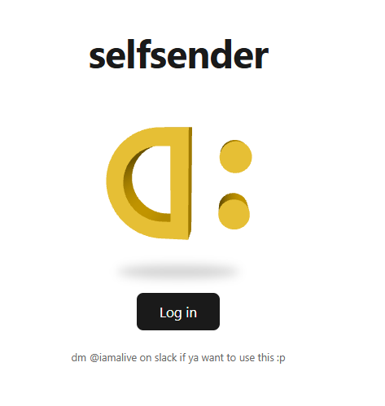

# selfsender

Thing that you can use to send messages as yourself in slack.
Mainly used for qol/info gathering purposes(I've been using it to find debtors from HCTG)

Could be used for asking questions on a big scale! (Think it'd be useful particularly for big ysws-es)

If you want to implement/use it yourself DM @Iamalive on the Hack Club Slack 

Check it out at selfsender.ckacha.dev

